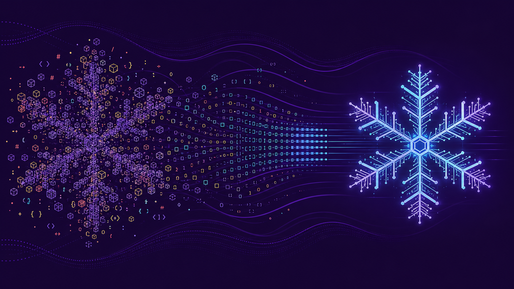
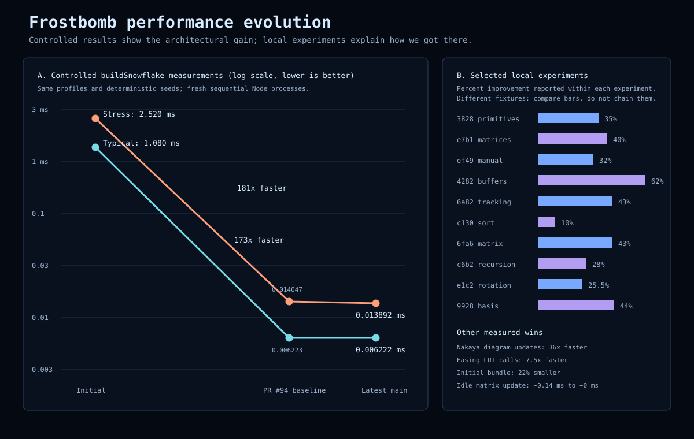

# From hundreds of meshes to 181x faster generation

Frostbomb's performance story is not one heroic micro-optimization. It is a
sequence of architectural changes followed by increasingly narrow hot-path
improvements.

The project began on April 17, 2026 with a clear, object-oriented Three.js
implementation. By June 12, 2026, the same high-level idea had become a
data-oriented pipeline that generates a typical snowflake in about 0.0062 ms
and a complex fernlike stress case in about 0.0139 ms on the development
machine.

The controlled initial-to-current comparison shows:

| Profile | Initial `1eb7d38` | Current main `f44ac51` | Improvement |
|---|---:|---:|---:|
| Typical weighted conditions | 1.07951 ms/build | 0.006222 ms/build | 173.5x faster |
| Fernlike stress case | 2.51991 ms/build | 0.013892 ms/build | 181.4x faster |

The controlled values were measured on `71b97b0`. Current main `f44ac51`
changes UI and reset-view behavior, while its geometry generator, random
inputs, benchmark files, package manifest, and lockfile are identical to the
measured revision. The generation numbers therefore carry forward unchanged.

The detailed evidence behind this article lives in
[`performance-timeline.csv`](performance/performance-timeline.csv). It records
controlled measurements, historical local experiments, operation-count
reductions, complexity changes, and qualitative architectural milestones.

The generated
[`performance-commit-inventory.csv`](performance/performance-commit-inventory.csv)
captures every non-merge commit on `main` whose subject or body contains a
performance-related term. It includes changed files and extracts quantitative
claims for audit. Regenerate it with `npm run performance:inventory`.

## How to read the numbers

The repository contains two kinds of performance evidence:

1. **Controlled comparisons** use the same deterministic profile and benchmark
   approach across revisions. These support the 173-181x headline.
2. **Recorded local experiments** compare a change against its immediate local
   baseline. They explain which ideas worked, but their fixtures, machines, and
   code states differ.

Local percentages must not be multiplied together or connected as one
continuous benchmark line. A change reported as 40% faster and a later change
reported as 30% faster may use different snowflakes, iteration counts, or
responsibilities. They are evidence of direction and mechanism, not a single
controlled time series.

This distinction matters because `buildSnowflake` itself changed meaning. The
initial function recursively created segments, cloned six arms, allocated a
material, constructed a `BoxGeometry` and `Mesh` for every visible branch, and
returned a Three.js group. The current function produces compact matrix and
delay arrays for a reusable instanced renderer.

## Phase 1: make rendering scale

The first version rendered each visible branch as its own Three.js mesh. For a
snowflake with `I` visible branches, object count, geometry count, disposal
work, and branch draw submissions all grew with approximately `I`.

Commit `7be6070` moved branches to `InstancedMesh`. That was the foundational
rendering change: branch rendering became a constant-sized structure instead
of hundreds of independent scene objects. It also made later matrix-buffer
optimizations possible.

The next lifecycle changes removed work that should not have happened at all:

- `4d7bae6` dynamically imported Tweakpane and removed GSAP, reducing the
  first-paint bundle from 263 KiB to 206 KiB gzipped, about 22%.
- `063bc7e` paused rendering while the page is hidden, deferred
  postprocessing until after the first render, respected reduced motion, and
  improved disposal.
- `7a423ab` gated idle matrix and DOM updates, reducing measured idle update
  time from about 0.14 ms to effectively zero.

The lesson was simple: the fastest frame work is work that never runs.

## Phase 2: stop constructing object graphs

The early generator used `Vector3` clones and segment objects throughout
recursive growth. Sixfold symmetry cloned those objects again, and rendering
turned them into individual meshes.

The transition away from that design happened incrementally:

- `3828de3` replaced `Vector3` work in recursive loops with primitive numbers.
  Its 500-build local benchmark improved from roughly 110 ms to 70 ms, about
  35%.
- `e7bfc02` retained animation metadata for one primary arm rather than all six
  symmetric copies. That reduced easing and property lookup work by 83%.
- `7507c21` wrote matrices and delays directly into typed arrays, removing
  intermediate instance objects and creating a fast path for non-animated Lab
  Mode updates.
- `6e46380` moved recursive segment output into a shared flat scratch buffer,
  eliminating thousands of short-lived allocations and improving locality.

This is where Frostbomb's generator stopped behaving like a scene-object
factory and became a data producer.

## Phase 3: make animation proportional to change

Once final matrices existed in packed arrays, the growth animation no longer
needed to rebuild complete transforms every frame.

The animation path evolved through several important reductions:

- `789dcb3` precomputed final matrices and replaced per-frame
  `Object3D.updateMatrix()` calls with component-wise scaling.
- `582b945` wrote only the changing 3x3 matrix basis, reducing matrix writes by
  about 44%.
- `b5bd8aa` sorted growth delays and stopped scanning at future segments,
  changing active-frame work from `O(N)` total segments to `O(A)` actively
  changing segments.
- `8cf83b6` adopted segment-major matrix layout, reducing GPU update ranges
  from six to one.
- `5be8fcb` batched completed-segment copies with `TypedArray.set`, reporting
  about 30% less animation-loop overhead.
- `5779f0d` exposed only branches that had started growing, preventing future
  branches from consuming vertex-shader work.

The renderer also reuses its `InstancedMesh`, grows capacity with headroom, and
uploads only changed matrix windows. Lab Mode therefore avoids repeated GPU
buffer churn during rapid slider movement.

## Phase 4: remove repeated general-purpose math

After the architecture was sound, profiles pointed to arithmetic inside
generation and animation:

- `dd75bce` replaced 200 snowfall sine calls per frame with one sine and one
  cosine using the angle-addition identity.
- `3a1d0e6` replaced repeated `Math.pow` easing calls with a 1,024-entry lookup
  table, measuring roughly 7.5x faster calls.
- `3061679` cached the static Nakaya diagram background, reducing 100 mocked
  updates from 18.5 ms to 0.5 ms, about 36x.
- `42824d5` reused one simplex-noise instance, used shared buffers, and applied
  small-angle Taylor approximations. Its complex-profile local benchmark moved
  from 0.117 ms to 0.044 ms.

These changes share a theme: calculate static or repeated information once,
then reuse it in the hot path.

## Phase 5: exploit snowflake-specific structure

The most sustained optimization work focused on what makes the problem
special: a snowflake is sixfold symmetric.

Instead of treating each arm as a general 2D rotation, the generator began
using fixed identities:

- the 60-degree rotation uses known constants;
- `R(120 degrees) = R(60 degrees) - I`;
- opposite arms are negations of the first three;
- one easing result applies to all six instances;
- matrix basis values can be hoisted from the `O(6S)` symmetry pass into the
  `O(S)` recursive growth pass.

Recorded local experiments include:

| Commit | Local result |
|---|---:|
| `c130a43` packed native typed-array sorting | about 10% faster overall; sorting about 6x faster |
| `6fa669a` reduced matrix population arithmetic | 0.074 ms to 0.042 ms |
| `c5e543e` unrolled symmetry population | 0.0468 ms to 0.0418 ms |
| `1ffb0a2` used negations for opposite arms | 0.048 ms to 0.042 ms |
| `16f0747` used the 120-degree identity | 0.136 ms to 0.122 ms on its huge profile |
| `c6b2698` inlined RNG and tracked recursive state additively | 0.085 ms to 0.061 ms |
| `e1c2f7b` hoisted the 60-degree direction rotation | 0.0403 ms to 0.0300 ms |
| `9928db0` hoisted matrix basis values into recursive growth | 0.080 ms to 0.0448 ms |

Not every plausible micro-optimization won in the complete benchmark. PR #94
replaced a generic six-arm loop with explicit identities, but a controlled
follow-up measured the complete stress profile about 4% slower. The later PR
#97 recovered about 1.1% on that same controlled stress profile.

That is healthy evidence. Optimization intent is not proof; the complete
benchmark decides.

## The improvement was broader than generation

The 181x headline describes CPU generation only. Other improvements target
different user-visible bottlenecks:

- first-paint JavaScript became about 22% smaller;
- Nakaya diagram updates became about 36x faster;
- idle matrix-update work fell from about 0.14 ms to effectively zero;
- snowfall trigonometry fell from 200 sine calls per frame to two trig calls;
- growth animation became proportional to active segments;
- GPU uploads became proportional to changed matrix windows;
- postprocessing and Lab Mode controls became deferred;
- hidden-page rendering became paused;
- reduced-motion mode lowers animation, particles, and initial quality;
- procedural texture loops improved by about 22% and 1.87x in focused
  arithmetic benchmarks.

These improvements cannot be reduced to one number because they affect
different moments: startup, regeneration, active growth, idle frames, Lab Mode,
mobile rendering, and hidden tabs.

## What the current numbers mean

At current `main` (`f44ac51`), whose generator is identical to latest measured
revision `71b97b0`:

- typical weighted generation: **0.006222 ms/build**, about 160,715 builds/s;
- fernlike stress generation: **0.013892 ms/build**, about 71,982 builds/s;
- stress generation consumes about **0.083%** of a 16.67 ms frame budget.

Generation is now too small to be the likely interactive bottleneck. Current
performance work should focus on browser-level and GPU-visible outcomes:

- time until the first snowflake is visibly rendered;
- scene and procedural texture initialization;
- physical-material and postprocessing GPU cost;
- mobile-device frame time;
- Lab Mode input-to-visible-update latency.

The project already has the architectural foundation for those measurements:
packed data, instancing, bounded updates, deferred work, and performance marks.

## Reproducing and extending the timeline

Use the process documented in
[`GENERATION_PERFORMANCE_HISTORY.md`](GENERATION_PERFORMANCE_HISTORY.md):

1. record the full commit SHA and environment;
2. build the benchmark bundle from that exact revision;
3. warm up before timing;
4. run profiles sequentially in fresh processes;
5. report medians, ranges, throughput, and branch counts;
6. keep different benchmark families separate;
7. verify build, tests, and visual behavior.

When adding a new result, add a row to
[`performance-timeline.csv`](performance/performance-timeline.csv) with its
evidence class and comparison family. Update the graph only when the new result
has a clearly compatible comparison or is explicitly presented as a local
experiment.
